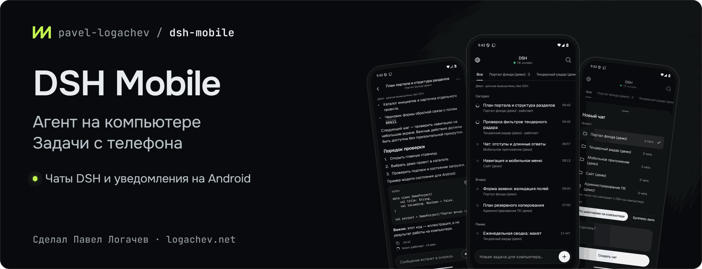
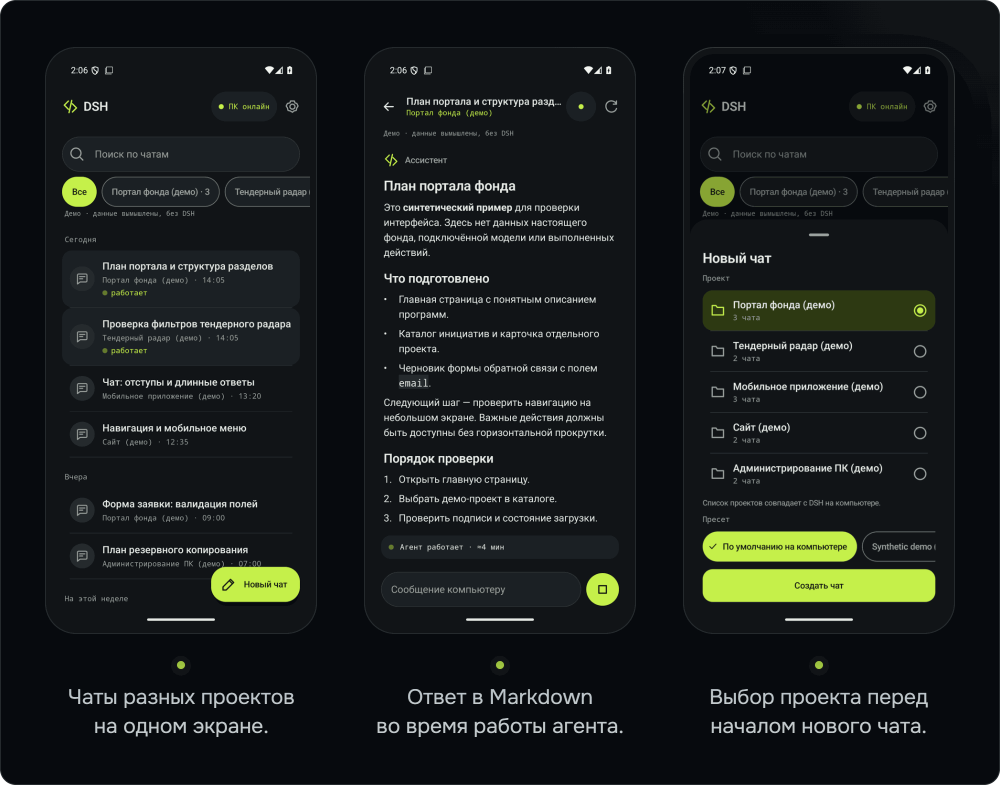

<picture><source media="(max-width: 767px)" srcset="docs/assets/dsh-mobile-banner-mobile.png"></picture>

# DSH Mobile

Case study on the website: <https://logachev.net/projects/#case-dsh-mobile> · Technical write-ups (in Russian) on Habr: [the plugin and pairing](https://habr.com/ru/articles/1099110/), [task notifications without Google push](https://habr.com/ru/articles/1103324/)

[](https://github.com/pavel-logachev/dsh-mobile/releases/latest) [](https://github.com/pavel-logachev/dsh-mobile/actions/workflows/ci.yml) [](<LICENSE>)

English | [Русский](README.ru.md)

**Your [DeepSeek Harness](https://github.com/deepseek-ai/deepseek-harness) agent runs on your computer. From your Android phone you assign tasks with photos and files, read replies in real time, answer the agent's questions and get an “Answer ready” notification.**

[Download 0.9.3](https://github.com/pavel-logachev/dsh-mobile/releases/tag/v0.9.3) · [Release notes](<docs/RELEASE_0.9.3.md>) · [Installation](#installation) · [Architecture](#how-it-works) · [Security](#security)

> An unofficial project by Pavel Logachev. Developed independently of DeepSeek.

Android 8.0+ · QR code pairing · Wi‑Fi or Tailscale

Models, tools and subscriptions stay on the computer. DSH Mobile has no cloud server.

## What's new in 0.9.x

The current release is **0.9.3** (8 November 2026): app 0.9.3 (versionCode 20) and companion plugin 0.9.3. The relay has not changed since 0.9.2. Upgrade the app and the plugin together.

**0.9.3**

- The "Waiting for the task result" notification now also clears when a task fails or you stop it. A stop you make yourself clears it silently, without an error alert.
- Fixed a "No connection" hang seen on Android 17: the app could treat itself as hidden while it was open, and "Reconnect" did nothing until restart. "Reconnect" now always starts a fresh round of attempts, even after automatic retries ran out.
- The chat no longer jumps while you send a message or the reply is streaming.
- A new "Working now" section at the top of the chat list shows chats with a running task, running subagents or a question waiting for you.
- After Stop, the "Sending…" card disappears as soon as the computer confirms the stop. Previously it stayed for 1–2 minutes.
- Chat search matches only your messages and the agent's replies. The app explains why it needs notifications before the first system prompt.

**0.9.2 and 0.9.1**

- Removing a task from the queue ends its watch with the `rejected` status instead of a stuck "Waiting for the result".
- Image sending is fixed, including large photos through a relay. Attachment uploads get a 120 s timeout, and HEIF/HEIC photos are converted to JPEG on Android 9+.
- Your answer to an agent question is kept after a DSH restart. Removing a message from the queue no longer shows a false error.

**0.9.0**

- Notifications now follow phone-started tasks: completion, failure and needs-answer through `GET /v1/sessions/{id}/prompt-outcomes` and capability `promptOutcomes`. No permanent idle connection notification or coverage banner. The old feed is retired: older apps report notifications unavailable on the new host, so upgrade both components together.
- Turn errors are shown in chat. Recovery hold/witness and `recovery-status`, `recovery-hold`, `recovery-release --new-epoch` support operator reconciliation, not exactly-once execution.
- At most 32 unsettled host dispatches; overflow is refused before admission. A ten-minute post-admission deadline settles as `uncertain`, without automatic replay.
- Network return wakes reconnect; online status follows the first authorized index page. Chat opens stream-first without an initial full GET; the first nonempty text is published immediately, with subsequent updates still throttled.
- DSH `0.2.1-rc.5` passed the full isolated canary: **25 checks**. [Evidence matrix](<docs/DSH_CANARY.md#compatibility-evidence>).

## What you can do from your phone

- **Open chats from all projects.** Search chats and filter them by project. The project list follows the DSH sidebar and updates without re-pairing.
- **Assign tasks.** Pick a project and a preset and write the task right away: the app creates a chat and sends the text once.
- **Send photos and files.** A shot from the camera, photos through the system photo picker (Photo Picker), files through the system file picker. Uploading starts as soon as you pick them. One message can carry up to 20 attachments with a total size of up to 200 MiB, each file up to 20 MiB. The agent receives PNG, JPEG, WebP and GIF images as images; files are handed to the DSH attachment store at the moment of sending. Unsent uploads expire on the computer after 10 minutes and never reach DSH.
- **Read the reply in real time.** Markdown, tables, code blocks with a copy button. Images from messages appear right in the conversation; tap one to open a full-screen viewer where you can zoom in, send it via Share or save it. Files from messages can be downloaded — up to 20 MiB. Service events are collapsed into an “Agent activity” line — the full text opens on tap. A long compacted chat whose older history cannot be restored within the limits opens with the latest messages and a note that the history is truncated.
- **Add messages and steer while the agent works.** By default a message joins the DSH queue and reaches the agent on its next turn. “Steer” delivers it at the agent's next step without stopping the current turn: hold the send button or tap ↳ on a queued message. You can also remove a message from the queue.
- **Answer the agent's questions.** Pick one or more options, write your own answer or skip the question. The option the agent recommends is marked but not preselected. Approvals of agent actions stay on the computer.
- **Rename a chat and change its model.** Both actions are in the ⋯ menu. The new model applies from the next model request, possibly as early as the next step of the running turn; a request that is already in progress is not switched.
- **Stop a run.** A separate Stop button asks for confirmation.
- **Get notifications for your tasks.** One local switch enables watches for phone-started tasks when the host publishes `promptOutcomes`. Completion, failure and needs-answer alerts open the corresponding chat; a final outcome replaces its waiting alert. Android channels control sound. Desktop-started tasks are not automatically watched. [Contract and limits](<docs/NOTIFICATIONS_0.9.md>).
- **Come back to the conversation.** Message search, a draft for each chat and copying with a long press.

Features are available only when the host reports their capability. Use the app and the plugin from the same release; the old notification feed is not a fallback. Attachments, queue/steer, question answers, rename, model choice and file downloads remain available.

The theme follows the system one; you can also choose light or dark manually. The interface is in Russian and English: the language follows the system or is chosen in the app settings. Large font sizes are supported.

<picture><source media="(max-width: 767px)" srcset="docs/assets/dsh-mobile-screens-mobile.png"></picture>

The screenshots were taken in the real app with synthetic demo data. They contain no real chats or connected models.

## Screenshots

Historical 0.8 screenshots; the notification screen does not describe the 0.9 design, and the "Working now" section is not shown.


DSH Mobile 0.8: the agent works on your computer, and your chat with it is on your phone.


Chats from all DSH projects in one list.


The agent is working and you add a message: to the queue, or “Steer” at the next step.


Camera photos, gallery pictures and files — in one message to the agent.


An agent question: pick an option, write your own answer or skip it.


The ⋯ menu: renaming the chat and changing the model.


An image from the chat in full screen: zoom in, share, save.


Notifications: the answer is ready, the agent has asked a question.

## How it works

A companion plugin is installed on the computer. It opens a narrow API to the paired phone over a secure connection but does not expose the DSH web interface to the outside.

```text
Android app
  │ HTTPS over Wi‑Fi or Tailscale
  │ or through your own relay
  ▼
Companion plugin inside DSH
  │
  ▼
Your projects and agents on the computer
```

The phone is only a client: the agent keeps working after you close the app. The main conversation history is stored in DSH on the computer.

The Android client is written in Kotlin and Jetpack Compose; the plugin runs on Node.js. Your own relay is an optional way to connect; the project does not provide a shared public relay.

## Installation

You can hand the detailed [setup guide](<docs/SETUP.md>) to your DSH agent. It contains environment checks, commands and separate approval of the installation, access rights and activation.

1. **Check the requirements.**

   Computer: Windows, DeepSeek Harness `0.2.0-rc.2`, `0.2.1-alpha.1` or `0.2.1-rc.5`, Node.js 24.x, OpenSSL 3. The main target is rc.5 (25 canary checks recorded for 0.9.0); the first two are retained on historical full/registry canaries, while rc.4 is unsupported. [Evidence limits](<docs/DSH_CANARY.md#compatibility-evidence>). Phone: Android 8.0+. DSH itself must run on Node 24, not just a suitable executable on PATH.

2. **Download and verify the release files.**

   Open the [latest release](https://github.com/pavel-logachev/dsh-mobile/releases/latest) (now [0.9.3](https://github.com/pavel-logachev/dsh-mobile/releases/tag/v0.9.3)). Download the signed APK, the host ZIP and both SHA-256 files from the same release; do not mix files from different releases. In older releases, `UNSIGNED-verification.apk` is verification evidence, not an installable download.

   Specify the absolute paths to the downloaded files and compare the hashes with the `.sha256` files. If they do not match, stop.

   ```powershell
   $zip = '<ABSOLUTE_DOWNLOADED_HOST_ZIP>'
   $apk = '<ABSOLUTE_DOWNLOADED_SIGNED_APK>'
   (Get-FileHash -LiteralPath $zip -Algorithm SHA256).Hash.ToLowerInvariant()
   (Get-FileHash -LiteralPath $apk -Algorithm SHA256).Hash.ToLowerInvariant()
   # Compare exactly with the release's .sha256 files. A mismatch means STOP.
   ```

3. **Prepare the plugin on the computer.**

   Extract the [installer](<tools/install-host.ps1>) from the archive and read it. In the commands below, replace the placeholders: the path to the script and the computer's address on your home network or in Tailscale. If you do not need an additional address, remove the second element of the array.

   ```powershell
   $installer = '<ABSOLUTE_REVIEWED_INSTALL_HOST_PS1>'
   $hosts = @('<ACTUAL_PRIMARY_LAN_OR_TAILSCALE_HOST>', '<OPTIONAL_ADDITIONAL_SAN>')
   # Remove the second element if not needed. Substitute approved real values locally.
   & $installer -ZipPath $zip -Hosts $hosts -WhatIf
   & $installer -ZipPath $zip -Hosts $hosts
   ```

   This step prepares the files and configuration but does not yet connect the plugin to DSH.

4. **Activate the plugin.**

   After reviewing the proposed changes:

   ```powershell
   & $installer -ZipPath $zip -Hosts $hosts -Activate
   ```

   The installer does not restart DSH. If the plugin has not started, follow the troubleshooting steps in the [guide](<docs/SETUP.md>): a restart may be needed, but it is approved separately.

   If home Wi‑Fi needs a Windows Firewall rule, add it only with the owner's consent and only for the private network. The installer does not change the firewall automatically.

5. **Install the APK on the phone.**

   Allow Android to install apps from the chosen source. Turn this permission off after installation.

6. **Pair the phone with a QR code.**

   On the computer, specify the directory of the installed plugin version and check the configuration:

   ```powershell
   $plugin = '<EXACT_LOCALAPPDATA_DSHMOBILE_PLUGIN_VERSION_DIRECTORY>'
   $cli = Join-Path $plugin 'dist/cli.js'
   $config = Join-Path $env:LOCALAPPDATA 'DSHMobile/host/host.json'
   node $cli verify-config --config $config
   ```

   Then choose **one** pairing command. Read-only access to all current and future projects:

   ```powershell
   node $cli pair --config $config --read all --ttl 300 --qr
   ```

   Or read access **and running tasks** in all of these projects — only if you agree to give the phone these rights:

   ```powershell
   node $cli pair --config $config --read all --execute all --ttl 300 --qr
   ```

   In the app, tap “Scan QR code”, check the computer's address and the certificate fingerprint, then confirm pairing. The camera is used only for scanning; the code is recognized without a network and without Google services.

**To use it away from home,** install Tailscale on the computer and the phone, connect both to your Tailscale network and specify the computer's name when preparing the plugin. You do not need to open a port on your router. The alternative is [your own relay on a VPS](<docs/RELAY_DEPLOYMENT.md>).

**Upgrading to 0.9.3:** upgrade app and host together after verifying signatures and hashes. An APK update must retain the signing certificate; do not uninstall to bypass a signature mismatch. Use the reviewed host installer with `-Upgrade -Activate`: it unmounts the old plugin, waits for listener closure and mounts the whole immutable build. A DSH restart needs separate approval because it ends running turns. Keep a private state backup and follow [upgrade/rollback instructions](<docs/SETUP.md#10-upgrade-rollback-revoke-and-uninstall>) and [release notes](<docs/RELEASE_0.9.3.md#upgrade>). The 0.9.3 APK is signed with the same key as earlier releases; on the owner's phone it was installed over the previous version with `install -r` and pairing was kept. The relay does not need an update.

## Security

- **Agent permissions stay the same.** The plugin runs inside DSH with its permissions. Project filtering is not a sandbox: an agent can do the same from the phone as from the computer. Give the right to run tasks only to trusted devices.
- **The invitation is a secret.** The QR code is single-use and valid for no more than 15 minutes. Do not publish it, send it to a chat or save it in shared logs. Pairing checks the computer's certificate, its validity period, the address and the pinned fingerprint.
- **Provider keys are not sent to the phone.** Pairing data is protected by Android Keystore and excluded from backups. The plugin's private files on Windows are accessible only to the owner of the user account.
- **Revoke a lost phone on the computer.** Signing out of the app locally deletes the pairing data from the phone but does not revoke access on the DSH side.
- **Notifications do not contain the completed answer.** Failure alerts may include a short summary; lock-screen content is private. Chat names use a localized fallback without fetching a transcript. [Details](<docs/NOTIFICATIONS_0.9.md#durable-watch-and-notification-state>).
- **The relay does not see chat contents.** It forwards encrypted traffic but sees IP addresses, timing and the amount of data transferred.

Do not expose the DSH web port to the outside and do not disable TLS verification. Details are in the [security overview](<docs/SECURITY.md>).

## Building from source

From the repository root, in PowerShell:

```powershell
cd host;  npm ci; npm ci --prefix ../relay; npm run check   # companion plugin, Node 24; the tests need the neighboring relay
cd ..\android
powershell -NoProfile -ExecutionPolicy Bypass -Command "& ../tools/android-build.ps1 -Tasks ':app:assembleDebug', ':app:testDebugUnitTest', ':app:lintDebug'"
```

JDK 21 is recommended; the Windows helper also supports JDK 17. You need Android SDK platform 36 and build-tools 36.0.0.

A regular release build of the APK is unsigned and cannot be installed as is. Building, packaging the plugin and signing with your own key are described in the [build guide](<docs/BUILD.md>) and the [APK release guide](<docs/ANDROID_RELEASE.md>).

## Release 0.9.3 checks

Recorded on 7–8 November 2026. Full details are in the [release notes](<docs/RELEASE_0.9.3.md#verification>); checks of earlier releases are in their own notes.

| Component | What was checked |
|---|---|
| Android 0.9.3 | On `0dff1c4`: 551 unit tests, 0 failures; lintRelease: 0 errors, 40 warnings |
| Plugin 0.9.3 | On `bac4018`: 389/389, 0 skipped. The host code has not changed since `bac4018` |
| Relay | 19/19, unchanged since 0.9.2 |
| Independent review | The watch fixes, the "Working now" section, the reconnect fixes and the Stop card fix each passed independent review after the findings were fixed. The plugin package passed a separate review: the reviewer rebuilt the ZIP from source and got the same bytes |
| APK signature | The same certificate as earlier releases, SHA-256: F9080C63B49A0BDE6B74AA2ADF7E9531D6C4F305978A24D3F5D271A39F1B7B95 |
| Physical phone | OnePlus CPH2747, ColorOS on Android 17. Stop, two runs: `rejected` / `user-stop`, no error alert, the "Sending…" card gone within 1.4 s. A 4-minute task in forced Doze with the screen off: the watch cleared within 1.4 s, the answer arrived once. "Reconnect" after exhausted retries started a connection 53–56 ms after the tap |

## Limitations

- **The computer and DSH must stay on.** The phone does not run an agent. One pairing targets one computer; the project list considers the first 100 registered projects.
- **This is intentionally a native subset, not desktop parity.** Plugin/skill management is not exposed. Action approvals stay on the desktop; they are distinct from answerable agent questions.
- **Known 0.9.3 limitations.** A very short task can finish before the waiting notification appears; the answer alert still arrives. Answers to agent questions are shown in a block after all messages, not at their place in time. [Details](<docs/RELEASE_0.9.3.md#known-limitations>).
- **Notifications are best effort, without FCM/UnifiedPush.** There is no idle service/permanent connection notification or coverage banner. A pending phone task still uses an FGS: its notification cannot be guaranteed invisible on all OEMs. Valid watches/outbox restore after process death and unlocked reboot subject to pairing, permission and OS guards. After force-stop, launch the app manually. Doze, battery saving, offline devices, 24-hour expiry or eviction from the 32-watch bound can prevent delivery. [Exact limits](<docs/NOTIFICATIONS_0.9.md>).
- **Offline content is a bounded stale/read-only cache.** At most 8 snapshots, 3500 KiB of serialized snapshot UTF-8, 24-hour age, each snapshot at most 2 MiB; the index is bounded separately. Cache is not authorization, command reconciliation or a full archive. Fresh snapshots contain at most 100 messages/2 MiB; older-history recovery is bounded to 16 pages/16 MiB. Upstream JSONL currently reads the whole log before those limits apply.
- **Updating DSH requires compatibility verification.** Setup may fill the version from `dsh --version`; the runtime plugin checks the configured declaration, not the installed version. Only the exact [matrix entries](<docs/DSH_CANARY.md#compatibility-evidence>) are supported.
- **A dropped connection does not prove non-delivery.** Automatic retry requires transport proof that **request headers** were not sent: at most three attempts with the same requestId. Never automatically resend after admission; a lost response or receipt404 never proves non-execution. A proven not-sent failure keeps the draft and offers manual Retry; for `uncertain`, inspect DSH first.
- **Recovery is not exactly-once.** A witness detects only provable local rollback. Missing/rolled-back DB and witness require a manual hold before reopening admission. Epoch is an operator decision record, not client-visible fencing: after release a lost requestId can be admitted as new. [Procedure](<docs/SETUP.md#restoring-the-command-ledger-from-a-backup>).

### Does the name require a DeepSeek model or subscription?

No. DSH Mobile is a companion to the DeepSeek Harness host, not a purchase of a particular DeepSeek model or plan. Models, providers and billing stay on the computer.

## Documentation

- [Installation, upgrade and removal](<docs/SETUP.md>)
- [Release notes 0.9.3](<docs/RELEASE_0.9.3.md>) and [all releases](https://github.com/pavel-logachev/dsh-mobile/releases)
- [Architecture](<docs/ARCHITECTURE.md>)
- [Mobile client protocol](<docs/PROTOCOL.md>)
- [Security](<docs/SECURITY.md>)
- [DSH integration](<docs/DSH_INTEGRATION.md>)
- [Deploying your own relay](<docs/RELAY_DEPLOYMENT.md>) and [its protocol](<docs/RELAY_PROTOCOL.md>)
- [Building from source](<docs/BUILD.md>)
- [Signing and releasing the Android APK](<docs/ANDROID_RELEASE.md>)
- [Contributing](<CONTRIBUTING.md>)

## Need something similar?

This project was built by [Pavel Logachev](https://github.com/pavel-logachev). I build websites, web services, Telegram bots, apps and automation for your task. AI agents write the code under my direction. I scope the task, review and ship. 20 years in IT: first as an engineer, then as a project manager. Tell me about your task [by email](mailto:pavel@logachev.net) or [on Telegram](https://t.me/pavel_logachev) — a 20–30 minute review is free, and you do not need a ready-made specification. Prices and other projects are on [logachev.net](https://logachev.net/) and [in my profile](https://github.com/pavel-logachev).

## License

[MIT](<LICENSE>) © 2026 Pavel Logachev. Third-party dependencies are distributed under their own licenses.
