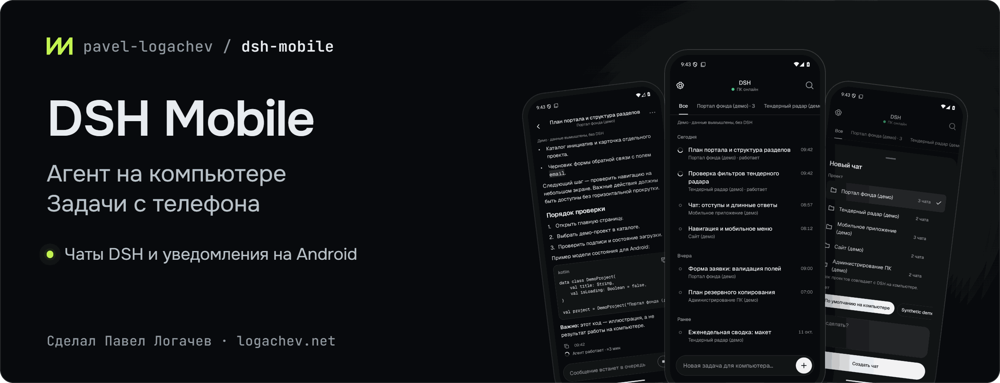
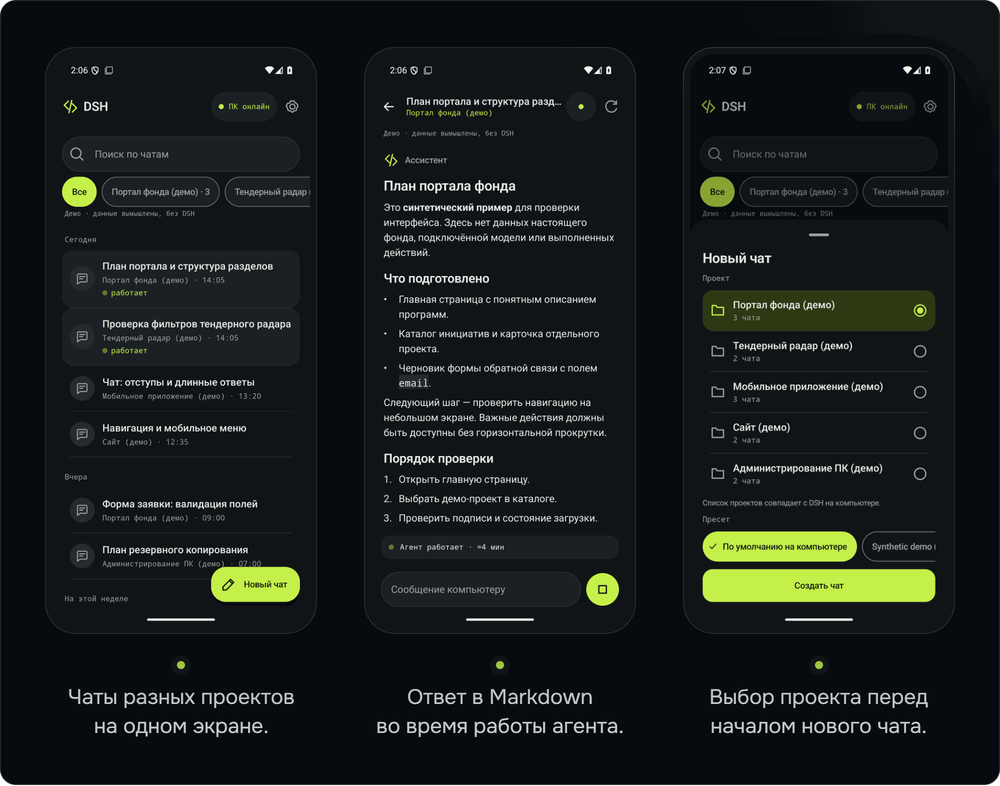

<picture><source media="(max-width: 767px)" srcset="docs/assets/dsh-mobile-banner-mobile.png"></picture>

# DSH Mobile

Кейс на сайте: <https://logachev.net/#case-dsh-mobile> · Статья в журнале: [DeepSeek Harness с телефона: как управлять агентом на компьютере с Android](https://logachev.net/journal/deepseek-harness-s-telefona-android/) · Разборы на Хабре: [плагин и привязка телефона](https://habr.com/ru/articles/1099110/), [уведомления о задачах без пушей Google](https://habr.com/ru/articles/1103324/)

[](https://github.com/pavel-logachev/dsh-mobile/releases/latest) [](https://github.com/pavel-logachev/dsh-mobile/actions/workflows/ci.yml) [](<LICENSE>)

[English](README.md) | Русский

**Ваш агент [DeepSeek Harness](https://github.com/deepseek-ai/deepseek-harness) работает на компьютере. С Android-телефона вы ставите задачи с фото и файлами, читаете ответы в реальном времени, отвечаете на вопросы агента и получаете уведомление «Ответ готов».**

[Скачать 0.9.3](https://github.com/pavel-logachev/dsh-mobile/releases/tag/v0.9.3) · [Описание выпуска](<docs/RELEASE_0.9.3.md>) · [Установка](#установка) · [Архитектура](#как-это-устроено) · [Безопасность](#безопасность)

> Неофициальный проект Павла Логачева. Разрабатывается независимо от DeepSeek.

Android 8.0+ · Привязка по QR-коду · Wi‑Fi или Tailscale

Модели, инструменты и подписки остаются на компьютере. Облачного сервера у DSH Mobile нет.

## Что нового в 0.9.x

Текущий выпуск – **0.9.3** от 8 ноября 2026 года: приложение 0.9.3 (versionCode 20) и плагин 0.9.3. Relay не менялся с 0.9.2. Приложение и плагин обновляйте вместе.

**0.9.3**

- Уведомление «Ждем результата задачи» теперь снимается и когда задача завершилась ошибкой или ее остановили. Если остановили вы сами, оно снимается молча, без уведомления об ошибке.
- Исправлено зависание «Нет связи» на Android 17. Приложение могло решить, что оно свернуто, хотя было открыто, и кнопка «Подключить снова» ничего не делала до перезапуска. Теперь она всегда начинает попытки заново, даже если автоматические уже исчерпаны.
- Лента чата больше не прыгает при отправке сообщения и пока печатается ответ.
- Новый раздел «Сейчас работают» вверху списка чатов. В нем чаты, где идет задача, работают субагенты или агент ждет ответа.
- После «Остановить» карточка «Отправляем…» исчезает, как только компьютер подтвердил остановку. Раньше она висела еще 1–2 минуты.
- Поиск по чату ищет только по вашим сообщениям и ответам агента. Перед первым системным запросом приложение объясняет, зачем нужны уведомления.

**0.9.2 и 0.9.1**

- Удаление задачи из очереди закрывает ожидание со статусом `rejected`, а не оставляет висеть «Ждем результата».
- Исправлена отправка изображений, в том числе крупных фото через relay. Для загрузки вложений таймаут 120 с, HEIF/HEIC на Android 9+ преобразуется в JPEG.
- Ответ на вопрос агента сохраняется после перезапуска DSH. Удаление сообщения из очереди больше не показывает ложную ошибку.

**0.9.0**

- Уведомления переделаны для задач, отправленных с телефона: завершение, ошибка и необходимость ответа через `GET /v1/sessions/{id}/prompt-outcomes` и capability `promptOutcomes`. Нет постоянного уведомления о связи и баннера покрытия в простое. Старый feed удален: старое приложение с новым host показывает уведомления недоступными — обновляйте оба компонента вместе.
- Ошибки хода видны в чате. Recovery hold/witness и команды `recovery-status`, `recovery-hold`, `recovery-release --new-epoch` помогают оператору разбирать восстановление журнала, но не дают exactly-once.
- До 32 незавершенных dispatch на host; превышение — отказ до admission. Десятиминутный deadline после admission переводит исход в `uncertain`, без автоматической повторной отправки.
- Возврат сети будит reconnect; «ПК онлайн» появляется после первой авторизованной страницы списка. Чат сначала открывает live stream без предварительного полного GET; первый непустой текст публикуется сразу, следующие обновления сохраняют throttle.
- Совместимость с DSH `0.2.1-rc.5` проверена полным изолированным canary: **25 проверок**. [Матрица evidence](<docs/DSH_CANARY.md#compatibility-evidence>).

## Что можно делать с телефона

- **Открывать чаты всех проектов.** Искать чаты и фильтровать по проекту. Список проектов следует боковой панели DSH и обновляется без повторной привязки.
- **Ставить задачи.** Выбрать проект и пресет и сразу написать задачу: приложение создаст чат и отправит текст один раз.
- **Отправлять фото и файлы.** Снимок с камеры, фотографии через системный выбор фото (Photo Picker), файлы через системный выбор файлов. Загрузка начинается сразу после выбора. В одном сообщении — до 20 вложений общим объемом до 200 МиБ, каждый файл — до 20 МиБ. Изображения PNG, JPEG, WebP и GIF агент получает как изображения, файлы передаются в хранилище вложений DSH в момент отправки. Неотправленные загрузки истекают на компьютере через 10 минут и в DSH не попадают.
- **Читать ответ в реальном времени.** Markdown, таблицы, блоки кода с копированием. Изображения из сообщений видны прямо в переписке; по нажатию открывается полноэкранный просмотр, где картинку можно увеличить, отправить через «Поделиться» или сохранить. Файлы из сообщений можно скачать — до 20 МиБ. Служебные события свернуты в строку «Действия агента» — полный текст доступен по нажатию. Длинный сжатый чат, старую историю которого не удается восстановить в пределах ограничений, открывается с последними сообщениями и пометкой, что история обрезана.
- **Дописывать и направлять, пока агент работает.** По умолчанию сообщение встанет в очередь DSH и дойдет до агента в следующем ходе. «Направить» доставляет его на следующем шаге агента, не останавливая текущий ход: удерживайте кнопку отправки или нажмите ↳ у сообщения в очереди. Сообщение можно и убрать из очереди.
- **Отвечать на вопросы агента.** Выбрать один или несколько вариантов, написать свой ответ или пропустить вопрос. Вариант, который рекомендует агент, отмечен, но не выбран заранее. Подтверждения действий агента остаются на компьютере.
- **Переименовывать чат и менять его модель.** Оба действия — в меню ⋯. Новая модель применяется со следующего запроса к модели, возможно уже на следующем шаге идущего хода; запрос, который уже выполняется, не переключается.
- **Останавливать работу.** Отдельная кнопка «Стоп» запрашивает подтверждение.
- **Получать уведомления о своих задачах.** Один локальный переключатель включает слежение за задачами, отправленными с телефона, если host публикует `promptOutcomes`. Завершение, ошибка и «Нужен ответ» открывают соответствующий чат; итог заменяет уведомление об ожидании ответа. Системные каналы управляют звуком. Desktop-задачи автоматически не отслеживаются. [Контракт и ограничения](<docs/NOTIFICATIONS_0.9.md>).
- **Возвращаться к переписке.** Поиск по сообщениям, черновик для каждого чата и копирование по долгому нажатию.

Функции доступны только при соответствующем capability host. Приложение и плагин берите из одного релиза; старый notification feed не является запасным путем. Вложения, очередь/«Направить», ответы на вопросы, переименование, модель и скачивание файлов сохраняются.

Тема следует системной, светлую или темную можно выбрать вручную. Интерфейс на русском и английском: язык следует системному или выбирается в настройках приложения. Поддерживается крупный шрифт.

<picture><source media="(max-width: 767px)" srcset="docs/assets/dsh-mobile-screens-mobile.png"></picture>

Снимки сделаны в настоящем приложении с синтетическими демо-данными. Реальных чатов и подключенных моделей на них нет.

## Скриншоты

Исторические снимки версии 0.8. Экран уведомлений не описывает схему 0.9, раздела «Сейчас работают» на них нет.


DSH Mobile 0.8: агент работает на компьютере, а чат с ним — у вас в телефоне.


Чаты всех проектов DSH в одном списке.


Агент работает, а вы дописываете: в очередь или «Направить» на следующем шаге.


Фото с камеры, снимки из галереи и файлы — в одном сообщении агенту.


Вопрос агента: выберите вариант, напишите свой ответ или пропустите.


Меню ⋯: переименование чата и смена модели.


Изображение из чата на весь экран: увеличить, поделиться, сохранить.


Уведомления: ответ готов, агент задал вопрос.

## Как это устроено

На компьютере устанавливается плагин-компаньон. Он открывает привязанному телефону узкий API через защищенное соединение, но не публикует наружу веб-интерфейс DSH.

```text
Android-приложение
  │ HTTPS по Wi‑Fi или Tailscale
  │ или через ваш собственный relay
  ▼
Плагин-компаньон внутри DSH
  │
  ▼
Ваши проекты и агенты на компьютере
```

Телефон — только клиент: агент продолжает работать и после закрытия приложения. Основная история переписки хранится в DSH на компьютере.

Android-клиент написан на Kotlin и Jetpack Compose, плагин работает на Node.js. Собственный relay — необязательный вариант подключения; общего публичного relay проект не предоставляет.

## Установка

Подробную [инструкцию установки](<docs/SETUP.md>) можно передать своему агенту DSH. В ней — проверки окружения, команды и отдельное согласование установки, прав доступа и активации.

1. **Проверьте требования.**

   Компьютер: Windows, DeepSeek Harness `0.2.0-rc.2`, `0.2.1-alpha.1` или `0.2.1-rc.5`, Node.js 24.x, OpenSSL 3. Основная целевая версия – rc.5 (25 canary checks записаны для 0.9.0); первые две оставлены по историческим full/registry canary, rc.4 не поддерживается. [Различия evidence](<docs/DSH_CANARY.md#compatibility-evidence>). Телефон: Android 8.0+. Node 24 нужен процессу DSH, не только PATH.

2. **Скачайте и проверьте файлы релиза.**

   Откройте [последний релиз](https://github.com/pavel-logachev/dsh-mobile/releases/latest), сейчас это [0.9.3](https://github.com/pavel-logachev/dsh-mobile/releases/tag/v0.9.3). Скачайте подписанный APK, архив плагина и оба файла SHA-256 из одного релиза, файлы разных релизов не смешивайте. В старых релизах `UNSIGNED-verification.apk` – проверочный артефакт, не файл для установки.

   Укажите абсолютные пути к скачанным файлам и сравните хеши с `.sha256`. При несовпадении остановитесь.

   ```powershell
   $zip = '<ABSOLUTE_DOWNLOADED_HOST_ZIP>'
   $apk = '<ABSOLUTE_DOWNLOADED_SIGNED_APK>'
   (Get-FileHash -LiteralPath $zip -Algorithm SHA256).Hash.ToLowerInvariant()
   (Get-FileHash -LiteralPath $apk -Algorithm SHA256).Hash.ToLowerInvariant()
   # Compare exactly with the release's .sha256 files. A mismatch means STOP.
   ```

3. **Подготовьте плагин на компьютере.**

   Извлеките из архива и прочитайте [установщик](<tools/install-host.ps1>). В командах ниже замените заполнители: путь к скрипту и адрес компьютера в домашней сети или Tailscale. Если дополнительный адрес не нужен, удалите второй элемент массива.

   ```powershell
   $installer = '<ABSOLUTE_REVIEWED_INSTALL_HOST_PS1>'
   $hosts = @('<ACTUAL_PRIMARY_LAN_OR_TAILSCALE_HOST>', '<OPTIONAL_ADDITIONAL_SAN>')
   # Remove the second element if not needed. Substitute approved real values locally.
   & $installer -ZipPath $zip -Hosts $hosts -WhatIf
   & $installer -ZipPath $zip -Hosts $hosts
   ```

   Этот шаг готовит файлы и конфигурацию, но еще не подключает плагин к DSH.

4. **Активируйте плагин.**

   После проверки предлагаемых изменений:

   ```powershell
   & $installer -ZipPath $zip -Hosts $hosts -Activate
   ```

   Установщик не перезапускает DSH. Если плагин не запустился, следуйте диагностике в [инструкции](<docs/SETUP.md>): перезапуск может потребоваться, но согласуется отдельно.

   Если для домашнего Wi‑Fi нужно правило брандмауэра Windows, добавляйте его только с согласия владельца и только для частной сети. Установщик не меняет брандмауэр автоматически.

5. **Установите APK на телефон.**

   Разрешите Android установку из выбранного источника. После установки отключите это разрешение.

6. **Привяжите телефон по QR-коду.**

   На компьютере укажите каталог установленной версии плагина и проверьте конфигурацию:

   ```powershell
   $plugin = '<EXACT_LOCALAPPDATA_DSHMOBILE_PLUGIN_VERSION_DIRECTORY>'
   $cli = Join-Path $plugin 'dist/cli.js'
   $config = Join-Path $env:LOCALAPPDATA 'DSHMobile/host/host.json'
   node $cli verify-config --config $config
   ```

   Затем выберите **одну** команду привязки. Только чтение всех текущих и будущих проектов:

   ```powershell
   node $cli pair --config $config --read all --ttl 300 --qr
   ```

   Или чтение **и запуск задач** во всех этих проектах — только если вы согласны дать телефону такие права:

   ```powershell
   node $cli pair --config $config --read all --execute all --ttl 300 --qr
   ```

   В приложении нажмите «Сканировать QR-код», сверьте адрес компьютера и отпечаток сертификата, затем подтвердите привязку. Камера нужна только для сканирования; код распознается без сети и без сервисов Google.

**Для работы вне дома** установите Tailscale на компьютер и телефон, подключите их к своей сети Tailscale и укажите имя компьютера при подготовке плагина. Открывать порт на роутере не нужно. Альтернатива — [собственный relay на VPS](<docs/RELAY_DEPLOYMENT.md>).

**Обновление до 0.9.3:** обновляйте приложение и host вместе, предварительно проверив подпись и хеши. APK для обновления должен иметь прежний сертификат; не удаляйте приложение ради обхода ошибки подписи. Host обновляется проверенным установщиком с `-Upgrade -Activate`: он unmount-ит прежний plugin, ждет закрытия listener и подключает целый immutable build. Если требуется restart DSH, согласуйте его отдельно — он завершает идущие ходы. Сохраните приватный backup состояния и используйте [инструкцию обновления/отката](<docs/SETUP.md#10-upgrade-rollback-revoke-and-uninstall>) и [описание выпуска](<docs/RELEASE_0.9.3.md#upgrade>). APK 0.9.3 подписан тем же ключом, что и прежние релизы. На телефоне владельца он установлен поверх прежней версии через `install -r`, привязка сохранилась. Relay обновлять не нужно.

## Безопасность

- **Права агента остаются прежними.** Плагин работает внутри DSH с его правами. Фильтр по проектам — не песочница: агент с телефона может делать то же, что и с компьютера. Право запуска задач давайте только доверенным устройствам.
- **Приглашение — секрет.** QR-код одноразовый и действует не дольше 15 минут. Не публикуйте его, не отправляйте в чат и не сохраняйте в общие журналы. При привязке проверяются сертификат компьютера, его срок действия, адрес и закрепленный отпечаток.
- **Ключи провайдеров не передаются на телефон.** Данные привязки защищены Android Keystore и исключены из резервных копий. Приватные файлы плагина на Windows доступны только владельцу учетной записи.
- **Потерянный телефон нужно отозвать на компьютере.** Локальный выход из приложения удаляет данные привязки с телефона, но не означает отзыв доступа на стороне DSH.
- **Уведомления не содержат готового ответа.** Ошибка может включать краткое описание; содержимое скрыто на экране блокировки. Для названия чата используется локализованный fallback без запроса переписки. [Подробности](<docs/NOTIFICATIONS_0.9.md#durable-watch-and-notification-state>).
- **Relay не видит содержимое чатов.** Он пересылает зашифрованный трафик, но видит IP-адреса, время и объем передачи.

Не публикуйте наружу веб-порт DSH и не отключайте проверку TLS. Подробнее — в [описании безопасности](<docs/SECURITY.md>).

## Сборка из исходников

Из корня репозитория, в PowerShell:

```powershell
cd host;  npm ci; npm ci --prefix ../relay; npm run check   # плагин-компаньон, Node 24; тестам нужен соседний relay
cd ..\android
powershell -NoProfile -ExecutionPolicy Bypass -Command "& ../tools/android-build.ps1 -Tasks ':app:assembleDebug', ':app:testDebugUnitTest', ':app:lintDebug'"
```

Рекомендуется JDK 21; Windows-помощник также поддерживает JDK 17. Нужны Android SDK platform 36 и build-tools 36.0.0.

Обычная release-сборка APK не подписана и не устанавливается как есть. Сборка, упаковка плагина и подпись своим ключом описаны в [инструкции по сборке](<docs/BUILD.md>) и [инструкции выпуска APK](<docs/ANDROID_RELEASE.md>).

## Проверки выпуска 0.9.3

Записаны 7–8 ноября 2026 года. Подробности – в [описании выпуска](<docs/RELEASE_0.9.3.md#verification>), проверки прежних релизов – в их описаниях.

| Часть | Что проверено |
|---|---|
| Android 0.9.3 | На `0dff1c4`: 551 модульный тест, 0 ошибок. lintRelease – 0 ошибок, 40 предупреждений |
| Плагин 0.9.3 | На `bac4018`: 389 из 389, без пропусков. После `bac4018` код плагина не менялся |
| Relay | 19 из 19, с 0.9.2 не менялся |
| Независимая проверка | Исправления ожидания задач, раздел «Сейчас работают», исправления связи и карточки после остановки прошли независимую проверку кода после исправления замечаний. Пакет плагина проверен отдельно: проверяющий заново собрал ZIP из исходников и получил те же байты |
| Подпись APK | Тот же сертификат, что у прежних релизов, SHA-256: F9080C63B49A0BDE6B74AA2ADF7E9531D6C4F305978A24D3F5D271A39F1B7B95 |
| Физический телефон | OnePlus CPH2747, ColorOS на Android 17. Ручная остановка, два прогона: `rejected` / `user-stop`, без уведомления об ошибке, карточка «Отправляем…» исчезла не позже чем через 1,4 с. Задача на 4 минуты в принудительном Doze с выключенным экраном: ожидание снялось не позже чем через 1,4 с, ответ пришел один раз. «Подключить снова» после исчерпанных попыток запускало подключение через 53–56 мс |

## Ограничения

- **ПК и DSH должны быть включены.** Телефон не запускает агента автономно; одна привязка относится к одному компьютеру. В списке учитываются первые 100 зарегистрированных проектов.
- **Это намеренно не весь desktop DSH.** Управление плагинами и skills на телефон не выведено. Approvals действий остаются на ПК; они отличаются от вопросов агента, на которые можно отвечать с телефона.
- **Известные ограничения 0.9.3.** Очень короткая задача может закончиться раньше, чем появится уведомление ожидания, уведомление с ответом при этом приходит. Ответы на вопросы агента показываются отдельным блоком после всех сообщений, а не на своем месте по времени. [Подробнее](<docs/RELEASE_0.9.3.md#known-limitations>).
- **Уведомления — best effort, без FCM/UnifiedPush.** Нет постоянной службы/уведомления в простое и баннера покрытия. Пока задача с телефона еще ожидается, работает FGS: невидимость его уведомления на всех OEM гарантировать нельзя. Валидные watches/outbox восстанавливаются после смерти процесса и разблокированного reboot при сохраненных привязке и разрешении. После force-stop откройте приложение вручную. Doze, энергосбережение, отсутствие сети, истечение 24 часов или вытеснение из лимита 32 watches могут помешать доставке. [Точные границы](<docs/NOTIFICATIONS_0.9.md>).
- **Офлайн доступен только ограниченный stale/read-only кэш.** До 8 снимков, суммарно 3500 КиБ сериализованного UTF-8, срок 24 часа; один снимок до 2 МиБ. Индекс ограничен отдельно. Кэш не подтверждает права или доставку команд и не является полным архивом. Свежий снимок содержит до 100 сообщений/2 МиБ, а восстановление старой истории ограничено 16 страницами/16 МиБ; upstream JSONL пока читает весь лог до этих ограничений.
- **Обновление DSH требует проверки совместимости.** Setup может заполнить версию из `dsh --version`; runtime plugin проверяет декларацию в настройках, а не обнаруживает установленную версию. Допустимы только точные версии из [матрицы](<docs/DSH_CANARY.md#compatibility-evidence>).
- **Обрыв связи не доказывает, что задача не отправлена.** Автоповтор допустим только при транспортном доказательстве, что заголовки **запроса** еще не отправлены: до трех попыток с тем же requestId. После admission автоматического resend нет; потерянный ответ или receipt404 не доказывает неисполнение. При доказанном not-sent черновик остается и доступен ручной Retry; при `uncertain` сначала проверьте DSH.
- **Recovery — не exactly-once.** Witness обнаруживает только доказуемый локальный rollback. При утрате/совместном откате DB и witness нужен manual hold до открытия admission. Эпоха — запись решения оператора, не client-visible fencing; после release потерянный requestId может быть принят заново. [Процедура](<docs/SETUP.md#restoring-the-command-ledger-from-a-backup>).

### Что означает название DeepSeek Harness?

DSH Mobile — companion к хосту DeepSeek Harness, а не покупка конкретной модели или подписки DeepSeek. Модель, провайдер и тариф выбираются на ПК.

## Документация

- [Установка, обновление и удаление](<docs/SETUP.md>)
- [Описание выпуска 0.9.3](<docs/RELEASE_0.9.3.md>) и [все релизы](https://github.com/pavel-logachev/dsh-mobile/releases)
- [Архитектура](<docs/ARCHITECTURE.md>)
- [Протокол мобильного клиента](<docs/PROTOCOL.md>)
- [Безопасность](<docs/SECURITY.md>)
- [Интеграция с DSH](<docs/DSH_INTEGRATION.md>)
- [Развертывание своего relay](<docs/RELAY_DEPLOYMENT.md>) и [его протокол](<docs/RELAY_PROTOCOL.md>)
- [Сборка из исходников](<docs/BUILD.md>)
- [Подпись и выпуск Android APK](<docs/ANDROID_RELEASE.md>)
- [Участие в проекте](<CONTRIBUTING.md>)

## Нужно похожее решение?

Проект сделал [Павел Логачев](https://github.com/pavel-logachev). Делаю сайты, веб-сервисы, Telegram-ботов, приложения и автоматизацию под задачу. Код пишут ИИ-агенты под моим руководством, я разбираю задачу, проверяю и запускаю. 20 лет в ИТ: инженер, затем руководитель проектов. Расскажите о задаче [на почту](mailto:pavel@logachev.net) или [в Telegram](https://t.me/pavel_logachev) — разбор на 20–30 минут бесплатный, готовое ТЗ не нужно. Цены и другие проекты — на [logachev.net](https://logachev.net/) и [в профиле](https://github.com/pavel-logachev).

## English

DSH Mobile is an unofficial Android client for DeepSeek Harness, developed independently of DeepSeek. Your agent runs on your computer; your phone lets you browse chats across projects, send tasks with photos and files, follow live Markdown replies with inline images, queue a message while the agent is working or steer it so the agent gets it at its next step, answer the agent's questions, rename a chat or change its model, and stop a run. Optional notifications tell you when an answer is ready or the agent has a question. Models, tools, subscriptions and canonical history stay on the computer.

Pair with a one-use QR code and connect over Wi‑Fi, Tailscale or your own optional relay. DSH Mobile provides no hosted cloud server or shared relay. A companion plugin exposes a narrow HTTPS API, not the DSH web UI. The phone verifies the computer's pinned certificate, and each device has revocable permissions. Project filtering is not a sandbox: agents retain their desktop tool permissions.

Requires Android 8.0+, Windows, DSH `0.2.0-rc.2`, `0.2.1-alpha.1` or `0.2.1-rc.5`, Node.js 24.x and OpenSSL 3. The current release is app/plugin **0.9.3** ([release notes](<docs/RELEASE_0.9.3.md>)). Upgrade both together: phone-task notifications use `promptOutcomes`, not the retired feed. No idle permanent notification or coverage banner; active-task FGS disclosure is still OEM-dependent. Pending watches may restore after unlocked reboot; force-stop requires a user launch. Approvals and plugin/skill management remain desktop-only. Follow the [setup guide](<docs/SETUP.md>) and use only reviewed published release assets.

Built by [Pavel Logachev](https://github.com/pavel-logachev): 20 years in IT, first as an engineer, then as a project manager. I build websites, web services, Telegram bots, apps and automation for your task. Have a similar one? [pavel@logachev.net](mailto:pavel@logachev.net) · [logachev.net](https://logachev.net/)

## Лицензия

[MIT](<LICENSE>) © 2026 Pavel Logachev. Сторонние зависимости распространяются под своими лицензиями.
